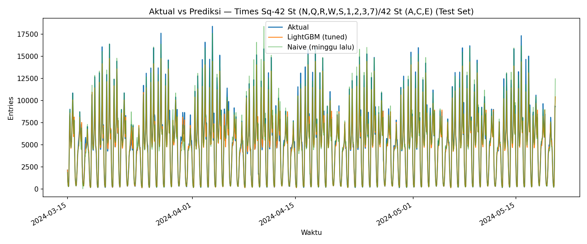
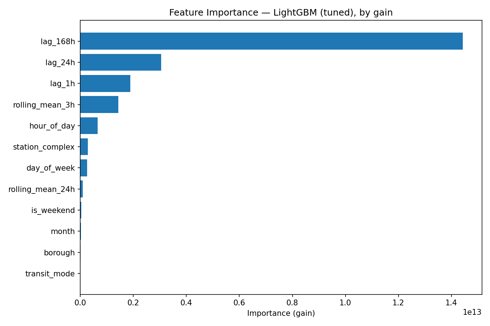

# Hourly Passenger Demand Forecasting for Mass Transit Stations

## Latar Belakang

Proyek ini membangun pipeline data science end-to-end untuk memprediksi jumlah penumpang (entries) per stasiun per jam pada jaringan transit massal, menggunakan data riil MTA (New York) sebagai studi kasus. Cakupan pekerjaan meliputi data profiling, cleaning skala besar (~7,5 GB), EDA, feature engineering, modeling time-series dengan LightGBM, hyperparameter tuning (Optuna) dengan experiment tracking (MLflow), evaluasi terhadap baseline, hingga dashboard interaktif untuk eksplorasi mandiri.

## Masalah

Operator transportasi massal butuh mengetahui **kapan** dan **di stasiun mana** kepadatan penumpang akan tinggi, supaya alokasi armada, jadwal, dan petugas lapangan bisa diatur secara proaktif — bukan reaktif setelah penumpukan terjadi. Tanpa model prediktif, perencanaan operasional hanya mengandalkan pola historis kasar atau intuisi.

## Tujuan

1. Membangun model forecasting jumlah penumpang per stasiun per jam yang mengungguli baseline naif.
2. Mengidentifikasi pola kepadatan: jam sibuk, perbedaan weekday vs weekend, stasiun dengan volume tertinggi/paling volatil.
3. Menyajikan hasil dalam dashboard interaktif untuk eksplorasi mandiri (filter stasiun, rentang waktu, aktual vs prediksi).

## Sumber Data

[MTA Subway Hourly Ridership 2022–2024 (Kaggle)](https://www.kaggle.com/datasets/yaminh/mta-subway-hourly-ridership-2022-to-2024) — granularitas per jam per stasiun, sumber asli data resmi MTA.

**Catatan penting:** skema kolom aktual dataset berbeda dari deskripsi awal — kolom volume penumpang bernama `ridership` (di-rename menjadi `entries` di pipeline ini), kategori tarif bernama `fare_class_category`, dan ada kolom tambahan `latitude`/`longitude`/`Georeference` yang tidak dipakai untuk forecasting per-jam. Detail lengkap ada di docstring [src/data_prep.py](src/data_prep.py).

`entries` adalah hitungan ridership/entry yang dilaporkan dataset, bukan orang unik. Jadi angka sekitar **10.818 entries/jam** di Times Sq saat jam puncak adalah rata-rata catatan entry untuk jam itu; angka tersebut tidak menyatakan 10.818 individu berbeda.

## Metodologi

### 1. Data Profiling & Cleaning ([src/data_prep.py](src/data_prep.py))
- Rentang waktu & jumlah stasiun ditentukan dari profiling data aktual (bukan asumsi): **2022-05-15 s/d 2024-05-20**, **428 stasiun** (`station_complex_id`), meliputi 3 moda transit (subway, Staten Island Railway, tram).
- 1 baris data error dikecualikan (station id "502" berlabel `transit_mode="subway"` untuk hanya 2 jam — data mislabel, seharusnya Staten Island Railway).
- Data diagregasi dari granularitas (stasiun, jam, payment_method, fare_class_category) menjadi (stasiun, jam), lalu di-reindex ke rentang jam penuh per stasiun — gap diisi 0 (bukan interpolasi), karena semua stasiun terverifikasi membentang penuh dari awal s/d akhir periode sehingga gap paling mungkin merepresentasikan nol tap tercatat, bukan data hilang acak.
- Outlier: clip nilai negatif ke 0, dan cap lonjakan ekstrem per stasiun di atas Q3 + 3×IQR (threshold longgar supaya jam sibuk/event wajar tidak ikut terpotong).
- File 7,5 GB memerlukan pendekatan khusus: lazy `scan_csv` + `sink_parquet` untuk memangkas kolom sebelum agregasi eager (streaming `group_by` langsung gagal alokasi memori di lingkungan dengan RAM ~10,5 GB).

| Metrik | Nilai |
|---|---|
| Baris mentah (granular fare/payment) | 51.208.979 |
| Baris setelah agregasi station-hour | 7.408.718 |
| Baris setelah reindex (gap terisi) | 7.560.192 |
| Gap jam yang diisi 0 | 151.474 (~2%) |
| Baris di-cap (lonjakan ekstrem) | 70.365 (0,93%) |

### 2. EDA ([notebooks/01_eda.ipynb](notebooks/01_eda.ipynb))
Insight kunci:
- Dua jam puncak jelas: **17:00** (~665 entries/jam rata-rata) dan **16:00** (~596), plus puncak pagi **08:00** (~581) — pola commuter klasik.
- **Weekday ~1,7x lebih padat** dari weekend (340 vs 202 entries/jam rata-rata).
- **Times Sq-42 St** mendominasi (~84,5 juta entries total sepanjang 2022-2024) — jauh di atas Grand Central (#2, ~59 juta).
- **Manhattan** menyumbang ~1,26 miliar entries — jauh melampaui borough lain (Staten Island hanya ~3,9 juta).
- Beberapa stasiun (mis. "5 Av/53 St (E,M)") punya volatilitas tinggi (coefficient of variation > 1,3).

### 3. Feature Engineering ([src/features.py](src/features.py))
- Lag: `lag_1h`, `lag_24h`, `lag_168h` — dihitung per stasiun, urut waktu.
- Rolling: `rolling_mean_3h`, `rolling_mean_24h` — dihitung dari `entries.shift(1).rolling_mean(...)` supaya tidak leakage (hanya memakai jam sebelum t).
- Kalender: `hour_of_day`, `day_of_week`, `is_weekend`, `month`.
- Kategorikal: `station_complex`, `borough`, `transit_mode` (pandas `category` dtype).
- 71.904 baris (168 jam × 428 stasiun) dibuang karena lag_168h NaN di awal deret tiap stasiun.
- `transfers` sengaja tidak dipakai sebagai fitur karena tercatat di jam yang sama dengan target (leakage).

### 4. Train/Validation/Test Split ([src/split.py](src/split.py))
Split time-based, proporsional terhadap rentang aktual (bukan angka tetap), dengan pengecekan anomali wajib sebelum finalisasi:

| Split | Rentang | Baris | % |
|---|---|---|---|
| Train | 2022-05-22 s/d 2024-01-02 | 6.056.628 | 80,9% |
| Validation | 2024-01-02 s/d 2024-03-15 | 749.856 | 10,0% |
| Test | 2024-03-15 s/d 2024-05-20 | 681.804 | 9,1% |

Titik potong 80% murni jatuh tepat di tengah periode libur Natal/Tahun Baru (ridership turun drastis, mis. 25 Des ~1,3 juta vs normal ~3,5-3,9 juta/hari). Batas train/validation **digeser** ke 2024-01-02 supaya seluruh periode libur masuk training dan validation dimulai dari kondisi representatif — bukan bias oleh anomali. Batas validation/test dicek dan tidak menunjukkan anomali, sehingga tidak digeser.

### 5. Tuning & Experiment Tracking ([src/train.py](src/train.py))
- Optuna, 18 trial, mencari `num_leaves`, `max_depth`, `learning_rate`, `n_estimators` (dengan early stopping), `min_data_in_leaf`, `feature_fraction`, `bagging_fraction`.
- Setiap trial tercatat ke MLflow lokal (`./mlruns`, file-based) via `mlflow.lightgbm.autolog()`.
- Best params (val MAE 25,95): `num_leaves=215, max_depth=11, learning_rate=0.0603, n_estimators=890, min_data_in_leaf=48, feature_fraction=0.623, bagging_fraction=0.918`.

### 6. Final Training & Baseline ([src/train.py](src/train.py), [src/baseline.py](src/baseline.py))
- Model final dilatih ulang dengan best params di atas **train+val digabung**, tanpa early stopping (`n_estimators` dipakai persis dari hasil koreksi `best_iteration_`).
- Baseline pembanding: **naive forecast** (`lag_168h`, nilai jam sama minggu lalu) dan **rolling average 24 jam**.

## Hasil Akhir: Evaluasi Rolling One-Step

Tabel ini mengikuti evaluasi awal proyek: model diperbarui setiap jam dan lag aktual yang tersedia sebelum jam target dipakai. Karena aktual dari jam-jam sebelumnya di dalam periode test ikut tersedia pada origin berikutnya, metrik ini **bukan** skor forecast 24 jam ke depan.

| Model | MAE | RMSE |
|---|---|---|
| **LightGBM (tuned)** | **25,06** | **65,95** |
| LightGBM (default, sebelum tuning) | 32,51 | 83,12 |
| Baseline naive (jam sama minggu lalu) | 42,24 | 111,13 |
| Baseline rolling average 24 jam | 219,88 | 482,83 |

- LightGBM (tuned) **40,7% lebih baik** dari baseline naive, dan **22,9% lebih baik** dari LightGBM default — tuning Optuna memberi kontribusi nyata, bukan formalitas.
- **Feature importance** (by gain): `lag_168h` mendominasi total gain, diikuti `lag_24h`, `lag_1h`, `rolling_mean_3h`, `hour_of_day` — pola mingguan/harian adalah sinyal terkuat. `station_complex`/`borough`/`transit_mode` kontribusinya kecil karena histori lag sudah menangkap "identitas" perilaku tiap stasiun secara implisit.




## Benchmark Forecast 24 Jam: Chronos-2, PatchTST, TimesFM, dan Baseline

Benchmark berpasangan memakai seluruh **428 stasiun hasil profiling**, 66 origin harian dari **15 Maret sampai 19 Mei 2024**, horizon 24 jam tanpa tumpang tindih, konteks historis 512 jam, dan 677.952 pasangan stasiun-jam. Semua model menerima origin dan target yang sama. Seasonal-naive mengambil nilai aktual minggu sebelumnya; LightGBM berjalan rekursif; Chronos-2 digunakan zero-shot secara multivariat; PatchTST dilatih secara global pada data sebelum test dengan 168 jam terakhir sebagai validation dan early stopping. Sembilan jam terakhir tidak masuk karena tidak membentuk satu horizon penuh.

| Model | MAE | RMSE |
|---|---:|---:|
| **Chronos-2 (zero-shot)** | **32,78** | **85,51** |
| LightGBM (rekursif, 24 jam) | 34,09 | 91,63 |
| TimesFM 3.0 (zero-shot) | 35,63 | 90,62 |
| Seasonal-naive (minggu lalu) | 42,39 | 111,35 |
| PatchTST (trained, maksimum 500 langkah) | 74,21 | 169,09 |

Pada evaluasi ini, Chronos-2 memiliki MAE **3,8% lebih rendah** daripada LightGBM rekursif dan **22,7% lebih rendah** daripada seasonal-naive; RMSE-nya juga yang terendah pada konfigurasi yang diuji. PatchTST baseline belum memadai pada konfigurasi satu model global ini. Ini menunjukkan konfigurasi training saat ini perlu ditingkatkan (misalnya tuning memakai validation pra-test, fitur kalender, atau model per kelompok stasiun), bukan kesimpulan bahwa arsitektur secara umum buruk. Perbandingan ini menguji konfigurasi yang dijalankan, bukan klaim tuning identik untuk setiap model.

Skor rolling one-step LightGBM 25,06 di atas tidak boleh dibandingkan langsung dengan skor 24 jam pada tabel ini karena informasi aktual yang tersedia untuk kedua skenario berbeda. Holdout yang sama pernah dipakai pada iterasi model proyek sebelumnya, sehingga hasil ini bersifat **benchmark eksploratif**, belum merupakan estimasi final yang benar-benar out-of-sample. Untuk klaim produksi, siapkan periode holdout baru dan validasi rolling-origin lanjutan.

Artefak benchmark: [metrics](models/chronos_patchtst_benchmark_metrics.csv), [MAE per horizon](models/chronos_patchtst_horizon_metrics.csv), [metadata](models/chronos_patchtst_benchmark_metadata.json), [prediksi Parquet](data/processed/chronos_patchtst_predictions.parquet), dan [grafik interaktif](models/chronos_patchtst_benchmark_overlay.html). Chronos-2 dan PatchTST berjalan di GPU lokal (RTX 3050, CUDA 12.8). Bobot Chronos-2 diambil dari [repositori resmi](https://github.com/amazon-science/chronos-forecasting) pada revision SHA tetap; implementasi PatchTST berasal dari [NeuralForecast](https://github.com/Nixtla/neuralforecast/blob/main/neuralforecast/models/patchtst.py). Source TimesFM 3.0 berlisensi Apache-2.0, tetapi **bobot TimesFM 3.0 terikat TimesFM Non-Commercial License v1.0**; jangan gunakan bobot unduhan ini untuk layanan komersial/produksi. Lihat [kartu model dan lisensi resmi](https://huggingface.co/google/timesfm-3.0-pytorch).

## Dashboard

- **Peta semua stasiun hasil profiling** (Plotly `scatter_mapbox`, gaya OpenStreetMap tanpa token) — ukuran & warna titik menunjukkan total entries tercatat pada rentang aktif, stasiun terpilih disorot. Lokasi disimpan di `data/processed/station_locations.parquet`.
- Filter stasiun berbasis `station_complex_id` dan rentang waktu. Preset 7/30 hari memakai hari kalender lengkap; pilihan seluruh periode/kustom dapat mencakup hari terakhir yang parsial.
- Forecast 24 jam per stasiun untuk aktual, Chronos-2, PatchTST, TimesFM, LightGBM rekursif, dan seasonal-naive; grafik one-step LightGBM tersedia terpisah.
- Ringkasan MAE/RMSE dan grafik horizon untuk benchmark multi-model, serta evaluasi one-step LightGBM yang diberi label terpisah.
- Peta dan profil jam sibuk mengikuti filter yang sama. `entries` adalah hitungan entry yang dilaporkan, bukan orang unik.
- Feature importance LightGBM.
- Feature importance (dihitung live dari model).
- Insight jam sibuk per stasiun (berdasarkan seluruh histori 2022-2024).

Sudah diuji langsung untuk stasiun tersibuk (Times Sq — puncak 17:00, ~10.818 entries/jam) dan stasiun sepi (Beach 105 St — puncak 07:00, ~18 entries/jam), keduanya render tanpa error dengan auto-scaling chart yang sesuai.

## Cara Menjalankan Proyek

### 1. Setup environment
```bash
pip install -r requirements.txt
```

### 2. Download dataset (jika belum ada di `data/raw/`)
```bash
python src/download_data.py
```

### 3. Jalankan pipeline berurutan
```bash
python src/data_prep.py      # cleaning -> data/processed/cleaned.parquet + station_locations.parquet
python src/features.py       # feature engineering -> data/processed/features.parquet
python src/split.py          # time-based split -> train/val/test.parquet
python src/train.py          # tuning Optuna + MLflow -> models/best_params.json
python src/train.py --final  # final training (train+val) -> models/lightgbm_final.txt
python src/baseline.py       # cek cepat metrik baseline
python src/evaluate.py       # evaluasi lengkap -> models/evaluation_metrics.csv + chart
python src/predict.py        # export model ke MLflow + data/processed/predictions.parquet
```

### 4. Jalankan dashboard
```bash
streamlit run dashboard/app.py
```

### 5. (Opsional) Lihat MLflow tracking UI
```bash
mlflow ui --backend-store-uri ./mlruns
```

### 6. (Opsional) Benchmark forecasting di Windows/NVIDIA

Environment khusus menjaga dependensi PyTorch benchmark dari pipeline utama. Benchmark Chronos-2/PatchTST memerlukan Python 3.12 dan GPU NVIDIA dengan driver yang sesuai.

```powershell
py -3.12 -m venv .venv-timesfm3
.\.venv-timesfm3\Scripts\python.exe -m pip install -r requirements-chronos-patchtst.txt
$env:HF_HOME = (Join-Path (Get-Location) ".hf-cache-timesfm3")
.\.venv-timesfm3\Scripts\python.exe src\download_timesfm3.py
.\.venv-timesfm3\Scripts\python.exe src\benchmark_timesfm3.py
.\.venv-timesfm3\Scripts\python.exe src\download_chronos2.py
.\.venv-timesfm3\Scripts\python.exe src\benchmark_chronos_patchtst.py
```

Jalankan pipeline utama sampai `src/data_prep.py` menghasilkan data bersih. Benchmark TimesFM membuat origin dan baseline bersama yang dipakai benchmark Chronos-2/PatchTST. Cache TimesFM ada di `.hf-cache-timesfm3/`, cache Chronos-2 di `.hf-cache-chronos2/`, dan checkpoint PatchTST di `.patchtst-checkpoints/` (semuanya diabaikan Git). `requirements-timesfm3.txt` tetap tersedia untuk instalasi TimesFM minimal yang terpisah.

## Struktur Proyek

```
project-root/
├── data/
│   ├── raw/                 # dataset asli (CSV, tidak di-commit karena besar)
│   └── processed/           # cleaned/features/train/val/test/predictions/station_locations.parquet
├── notebooks/
│   └── 01_eda.ipynb
├── src/
│   ├── download_data.py
│   ├── data_prep.py
│   ├── features.py
│   ├── split.py
│   ├── train.py
│   ├── baseline.py
│   ├── evaluate.py
│   └── predict.py
│   ├── download_chronos2.py
│   ├── benchmark_chronos_patchtst.py
│   ├── download_timesfm3.py
│   └── benchmark_timesfm3.py
├── models/                  # model, metrik, chart, dan metadata benchmark
├── dashboard/
│   └── app.py
├── requirements.txt
├── requirements-chronos-patchtst.txt
├── requirements-timesfm3.txt
└── README.md
```

## Future Work

- **Temporal Fusion Transformer (TFT)** atau model deep learning time-series lain berpotensi menangkap pola non-linear/multi-horizon lebih baik, tapi di luar scope proyek ini karena kompleksitas setup & training — cukup dicatat sebagai kemungkinan pengembangan lanjutan.
- Validasi benchmark multi-step 24 jam pada periode holdout baru, karena holdout saat ini telah dipakai dalam iterasi proyek sebelumnya dan hasilnya masih eksploratif.
- Fitur eksternal: cuaca, event kalender (konser, olahraga), gangguan layanan (service disruption) yang diketahui berkorelasi dengan lonjakan/penurunan ridership.
- Model per-cluster stasiun (bukan satu model global) untuk menangkap karakteristik stasiun yang sangat berbeda (mis. hub besar vs stasiun residensial kecil) dengan lebih presisi.
